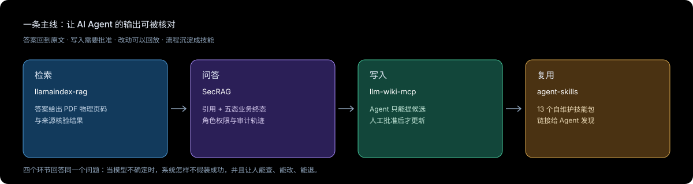

# Jaron Lu

**一句话**：让 AI Agent（能自己调用工具、分步骤做事的程序）的输出可被核对——答案能回到原文，写入要有人批准，改动能退回去。

十年 iOS / HarmonyOS 客户端开发，现在专注 Agent 工程。下列项目均为个人独立完成的架构验证，不含客户数据或客户定制代码。

## 四个项目，一条主线

- **检索**：[llamaindex-rag](https://github.com/jaronlu/llamaindex-rag) — 每条答案给出 PDF 物理页码与来源核验结果。
- **问答**：[SecRAG](https://github.com/jaronlu/SecRAG) — 引用、五态业务终态、角色权限与审计轨迹。
- **写入**：[llm-wiki-mcp](https://github.com/jaronlu/llm-wiki-mcp) — Agent 只能提候选，人工批准后才更新正式页面。
- **复用**：[agent-skills](https://github.com/jaronlu/agent-skills) — 13 个自维护技能包，链接给兼容的 Agent 发现。

## 怎么自己核对

每个仓库 README 首屏都给出一条 30 秒可跑命令和一组可复现数字（提交数、源码规模、测试用例数），并写明统计口径与复现命令。数字不是自评，读者可以自己跑一遍。

## 边界

- 这些项目是架构验证与分阶段学习验证，不是生产系统。
- 不做生产可用性与性能承诺；已知限制写在各仓库 README 的边界章节。

## 更多

个人站：[jaronlu.github.io](https://jaronlu.github.io)
